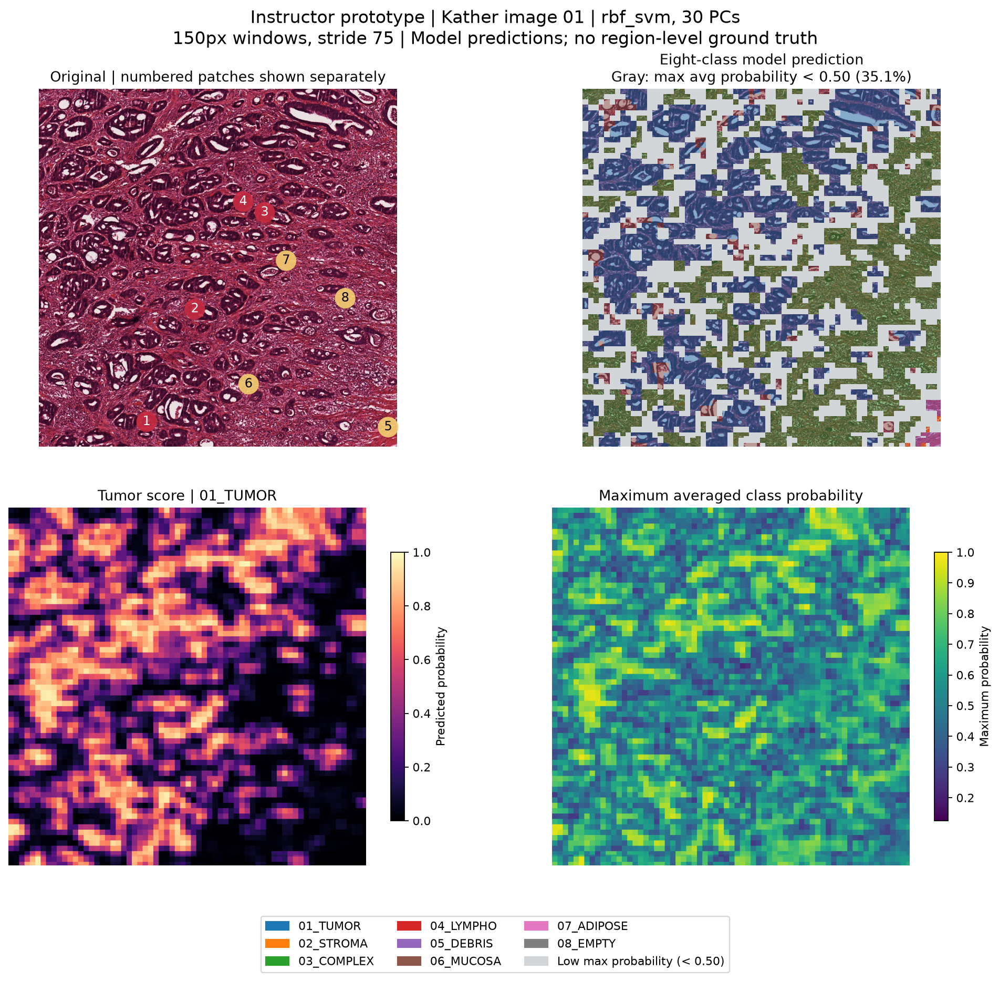

# Python Workshop — Build Machine Learning from Scratch

A 10-week, hands-on Python workshop for students in biology and biotechnology. Each 90-minute session alternates between short explanations and immediate practice.

You will build one `mini_ml` package that grows throughout the course:

```text
mathematical idea → implementation (pure Python in Weeks 1–4, NumPy from Week 5) → tests → reference comparison
```

You will connect statistics and information theory to NumPy preprocessing, PCA, multiclass logistic regression and a reproducible pathology-image scanning application. You will implement the numerical core; the instructor supplies data preparation and plotting scaffolds.

## What you will build

```text
RGB pathology tiles → training-only PCA → your multiclass logistic classifier → large-image probability maps
```

Your final product will include image reconstructions, a PC1–3 3D distribution, validation comparisons, a held-out test confusion matrix, and tissue/tumor probability maps on a larger pathology image.



*Teacher model prediction demonstration: scikit-learn PCA + RBF SVM (30 PCs). Gray marks regions where the maximum averaged class probability is below 0.5: 35.1% of the display. This is a visualization rule; the large image has no regional ground truth. The required student project will use your PCA and hand-written multiclass logistic regression.*

See the [final-project preview](docs/final-project-preview.md) for reconstructions, PC distributions, classification results, data sources and interpretation limits.

## Current materials

- [Week 6 lesson](weeks/week-06/lesson.md): centering, sample covariance, directional variance and the native variance explorer.
- [Intro to PCA](teaching/intro-to-pca/README.md): interactive visual introduction to modes, eigenfaces, covariance and reconstruction.
- [Week 5 lesson](weeks/week-05/lesson.md) and [Intro to NumPy](teaching/intro-to-numpy/README.md).
- Lessons: Weeks 1–6. Reference solutions: Weeks 1–5. Weeks 7–10 are planned milestones; their runnable lessons will be released later. Check `course.json` for the current release state.

## Start here

Before your first class:

1. Create a GitHub account.
2. Install [Git](https://git-scm.com/downloads).
3. Install [uv](https://docs.astral.sh/uv/getting-started/installation/).
4. Ask the instructor to register your GitHub login and assigned folder in the course roster.
5. Accept Write access to this repository.

Check your installation:

```sh
git --version
uv --version
```

Use these placeholders throughout the instructions:

- `<login>`: your exact GitHub login.
- `<folder>`: the `name_studentnumber` folder registered by the instructor.

## What to read, edit, and leave alone

| Path | Purpose | What you should do |
| --- | --- | --- |
| `README.md` | Course workflow and submission rules | Read this first |
| `SYLLABUS.md` | Ten-week learning sequence | Read for the course overview |
| `weeks/week-XX/lesson.md` | Instructions for the current week | Read carefully and follow in order |
| `weeks/week-XX/fragments/` | Incomplete starter snippets | Read and manually integrate into your package |
| `weeks/week-XX/demo.py` | Example of how the completed API is used | Read or run the synced copy |
| `students/<folder>/` | Your cumulative package and tests | This is your working and submission area |
| `tests/week-XX/` | Shared course acceptance tests | Read-only; do not modify |
| `tools/course.py` | Sync and local acceptance commands | Run it; do not modify it |
| `tools/`, `.github/` | Trusted grading and CI infrastructure | Do not modify |
| `course.json`, `roster.json` | Instructor-managed release and identity settings | Do not modify |
| `students/<someone-else>/` | Another student's work | Do not modify |

See [ARCHITECTURE.md](ARCHITECTURE.md) for the cumulative package design and [CONTRIBUTING.md](CONTRIBUTING.md) for concise PR rules.

## Your workspace

Every student uses the same layout but has an independent environment and implementation:

```text
students/<folder>/
├── pyproject.toml
├── uv.lock
├── README.md
├── src/
│   └── mini_ml/       # Reusable functions and models; commit
├── tests/             # Your unit tests; commit
├── test_code/         # Local experiments, plots, and debugging; do not commit
├── examples/          # Week 10 biological application; commit
└── data/
```

This is one package that grows over ten weeks. Week 3 extends statistics; Week 5 adds a NumPy Standardizer. The planned continuation adds PCA, a hand-built softmax classifier and pathology scanning, with stable numerical module paths. See SYLLABUS.md for the learning roadmap; course.json lists released lessons and solutions.

## Week 1 — Build Your First Installable Python Package

Clone the class repository and create a branch inside this repository:

```sh
git clone https://github.com/Stat-ML-Python-Workshop/python-workshop.git
cd python-workshop
git switch -c <login>/week-01
mkdir -p students/<folder>
cd students/<folder>
```

Do not use a fork. The acceptance workflow requires the PR branch to belong to the class repository.

Follow [the Week 1 lesson](weeks/week-01/lesson.md) to create `pyproject.toml`, the `src/mini_ml/` package, unit tests, and local `test_code/` experiments by hand. You may use AI to help create a skeleton, but you must be able to explain the purpose of every file and fix the code yourself.

Create and verify the environment:

```sh
uv venv --python 3.12
uv pip install -e .
uv lock
uv sync --frozen
uv run python test_code/try_package.py
uv run pytest
```

Week 1 is complete when the package installs in a clean environment, an external program can run `from mini_ml import hello_world`, your own tests pass, and the trusted CI acceptance check passes.

## Weeks 2–10 — Extend the same package

Start a new week only after the previous week's PR has been merged:

```sh
git switch main
git pull --ff-only
git switch -c <login>/week-02
uv run --no-project --python 3.12 python tools/course.py sync <login> 2
```

The sync command adds local demos, data and supplied tests when provided. It never creates, replaces, or edits your package modules, and it preserves existing files.

Next:

1. Read `weeks/week-02/lesson.md`.
2. Compare the starting and target structures.
3. Read the starter snippets in `weeks/week-02/fragments/`.
4. Manually integrate the requested changes into your existing package.
5. Run a small test after each change.
6. Confirm that all previous-week behavior still works.

Some weeks append to existing modules; do not replace the entire file. Week 8 includes file moves and import updates while preserving your earlier implementations.

Run the trusted local acceptance tests from the repository root:

```sh
uv run --frozen --project students/<folder>   python tools/course.py test <login> 2
```

Replace `2` with the current week number.

## Local experiments versus submitted work

From your package directory, you can run:

```sh
uv run python test_code/try_package.py
uv run pytest
```

Use `test_code/` for exploratory scripts, temporary datasets, generated plots, and debugging output. It stays on your computer and is excluded from formal grading.

Put reusable calculations in `src/mini_ml/`. Put lasting unit tests in `tests/`.

Never force-add local files with `git add -f`. The CI rejects any submitted path containing `test_code/`.

## Submit your work

Before committing, return to the repository root and inspect exactly what changed:

```sh
git status
git diff
git add students/<folder>
git diff --cached --name-only
```

Every staged file must be inside your registered `students/<folder>/` directory.

Commit and push:

```sh
git commit -m "Complete week 02 core exercise"
git push -u origin <login>/week-02
```

Open one pull request with:

- Base branch: `main`
- Head branch: `<login>/week-XX`
- Title: `[Week XX] <login>`

Complete the PR template with your implementation summary, local test results, reference-solution usage, and remaining questions.

If CI fails, fix the same branch and push again. Do not open a second PR.

## What the CI checks

The trusted `Workshop acceptance` workflow verifies:

1. The PR author is registered in the roster.
2. The branch is named `<GitHub-login>/week-XX`.
3. The requested week has been released.
4. Every changed path belongs to the student's registered folder.
5. No `test_code/` files were submitted.
6. The package can be installed and imported in an isolated container.
7. Student and shared course tests pass.
8. The result belongs to the latest commit in the PR.

A green check with the exact status name `workshop/acceptance` is the official completion signal.

## Files you must not commit

Keep these local:

```text
.venv/
test_code/
.pytest_cache/
__pycache__/
*.pyc
*.egg-info/
```

Commit these when they are part of the exercise:

```text
pyproject.toml
uv.lock
README.md
src/mini_ml/
tests/
examples/
```

## Weekly schedule

| Time | Activity |
| --- | --- |
| After Tuesday's class | Implement the current exercise and open a PR |
| Thursday evening | The instructor releases `reference/week-XX/` |
| Friday | The latest PR commit must pass `workshop/acceptance` |
| Later | Instructor review and merge may happen separately |

If your work does not pass by Friday, continue correcting the same PR.

## Reference solutions

Reference solutions are released after the initial work period. Each release contains:

- A human-readable integration guide in `reference/week-XX/README.md`
- Completed code fragments in `reference/week-XX/fragments/`

Use only the fragments you need, integrate them into your existing package, rerun all cumulative tests, and state your level of reference use in the original PR.

Weekly lessons and solutions are released in stages. The high-level roadmap and an instructor prototype preview are available now; unreleased solution code, instructor-only notes, private data and credentials remain outside this repository.

## Final project — Pathology classification and scanning (planned)

Weeks 6–10 build toward the final product shown above. Implement training-only PCA, a hand-written eight-class softmax classifier, and overlapping-window probability aggregation. Compare your classifier with scikit-learn; optional SVM and PyTorch work is separate from the required implementation.

The planned image dataset is [Kather 2016](https://zenodo.org/records/53169): 5,000 RGB tiles in eight tissue classes, with a fixed seed-42 60%/20%/20% train/validation/test split. Fit PCA on training images, choose PC count and model settings on validation, then freeze the pipeline before evaluating test data. WDBC remains the introductory tabular dataset in the earlier weeks.

The final-project CLI and executable acceptance will be provided with later lessons. Until then, use the [preview](docs/final-project-preview.md) to understand the target artifacts. Tile-level classification results do not establish patient-independent performance, and unannotated large-image prediction maps do not establish localization accuracy.

## Getting help

When asking for help, include:

- The week number
- The command you ran
- The complete error message
- The output of `git status`
- What you expected to happen

Do not post passwords, access tokens, private datasets, or other credentials.
