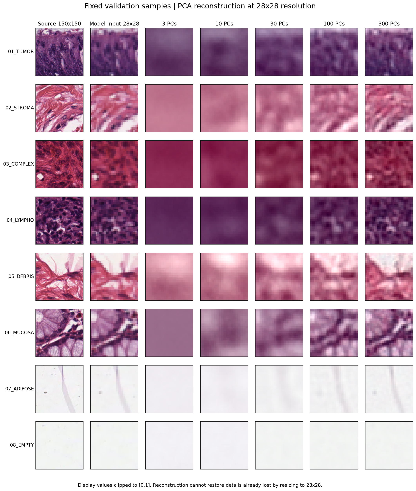
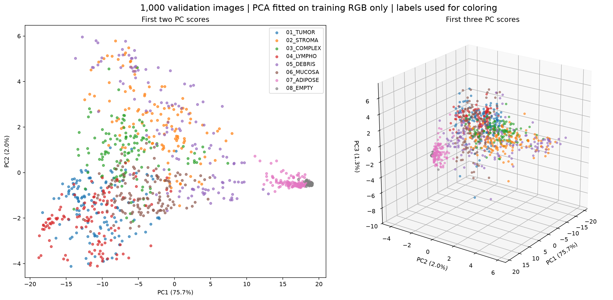
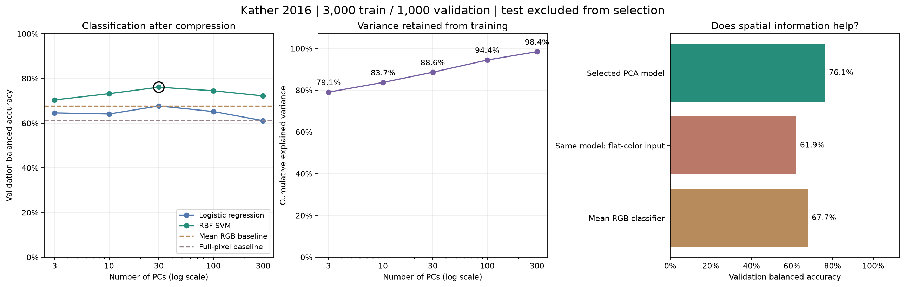
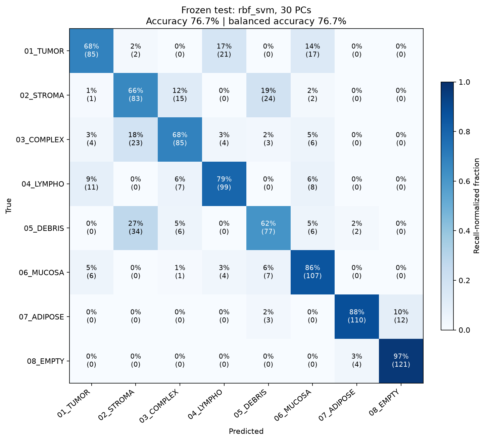
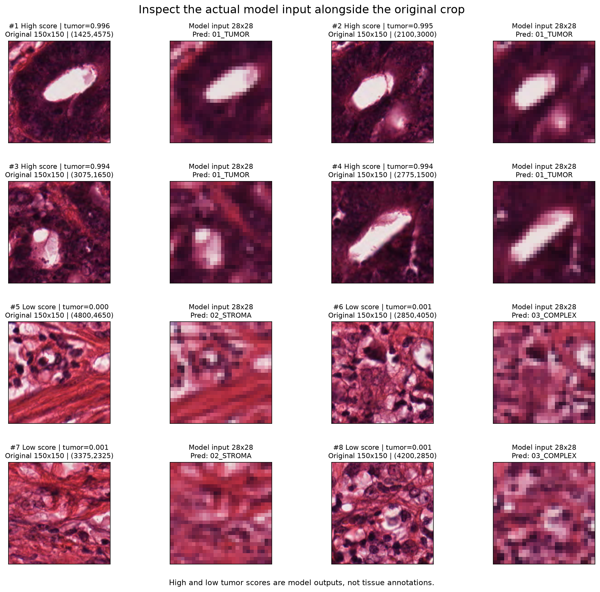

# Final project preview: pathology classification and scanning

This gallery illustrates the planned Week 6–10 outputs using an **instructor feasibility prototype**. Those weeks do not yet have released executable assignments. The prototype uses scikit-learn PCA and classifiers; the required student project will use student-implemented PCA and a hand-written eight-class logistic classifier.

## The pipeline you will build

```text
RGB tile (150×150×3)
    → resize to 28×28×3, flatten and divide by 255: 2,352 features
    → PCA fitted on training only: k PC scores
    → your eight-class logistic classifier: 8 probabilities
    → scan a larger image and average probabilities in overlapping windows
```

Use labels to train/evaluate the classifier and color scatter plots. PCA itself receives image features without labels. Three PCs support visualization; validation will select a suitable PC count for classification.

| Week | Connection to the product |
| --- | --- |
| 5 | Learn NumPy shapes, saved fit/transform parameters and plotting on WDBC |
| 6 | Understand centering, covariance and high-variance directions |
| 7 | Project, reconstruct and measure reconstruction error |
| 8 | Implement the PCA object and visualize PC scores/components |
| 9 | Train your eight-class softmax regression classifier |
| 10 | Freeze the pipeline, evaluate test once and generate scan maps |

## 1. Original images and PCA reconstructions



The first column is the original 150×150 tile; the second is the 28×28 input the model sees. Subsequent columns reconstruct that input with increasing PC counts. More PCs can restore detail within the thumbnail; they cannot restore detail already removed by resizing. Reconstruction quality and classification ability are separate questions.

## 2. First three PC scores



Each point represents one validation tile. Its coordinates are PC scores; its color is the original tissue class. PCA was fitted on training RGB features only. Class overlap is allowed: high-variance directions are not automatically the most predictive directions for tumor classification.

## 3. Compression and classification



The prototype compares 3, 10, 30, 100 and 300 PCs with scikit-learn Logistic Regression and RBF SVM. Settings are selected on validation balanced accuracy. The selected prototype is **30 PCs + RBF SVM**, retaining **88.6%** of training variance.

| Prototype comparison | Validation balanced accuracy | Final test balanced accuracy |
| --- | ---: | ---: |
| Mean RGB + scikit-learn Logistic Regression | 67.7% | Not evaluated |
| 30 PCs + scikit-learn Logistic Regression | 67.7% | Not evaluated |
| 30 PCs + RBF SVM (validation-selected) | 76.1% | 76.7% |

**76.7% is the SVM prototype result, not a result from the future hand-written student classifier.** The main project must report the student's classifier even if an optional reference model scores higher. There is no minimum accuracy requirement.

Replacing each validation image with a constant-color tile preserving its mean RGB reduced the selected prototype's balanced accuracy from 76.1% to 61.9%. This supports using information beyond mean color; it does not identify a particular biological structure.



The test set was used once after validation selection. Because the split unit is the individual tile and patient independence is not established, this is a teaching experiment rather than evidence of patient-independent performance.

## 4. Large-image scanning


The prototype scans a 5,000×5,000 image using 150×150 windows and stride 75, adding the last complete window at each boundary: **4,356 tiles**. Each tile uses the same thumbnail preparation, saved PCA and fixed classifier as the small-image experiment. Overlapping windows contribute averaged probabilities.

These are model prediction maps. The large image has no regional ground truth, so the maps do not measure localization accuracy. Maximum class probability is a model score, not proof that a region was classified correctly.

In the eight-class map, **light gray marks display cells whose maximum overlap-averaged class probability is below 0.5**, covering **35.1%** of this display. This is a visualization rule to show uncertainty; it is not a ninth tissue class or a validated rejection threshold. The legend distinguishes light-gray low-score cells from the darker `08_EMPTY` class. The model probabilities and the continuous tumor/maximum-score maps are preserved. Colored cells can also be misclassified.



Inspect original crops and actual model inputs together. This makes it possible to discuss whether an apparent pattern survives resizing and whether the predictions have convincing visual support.

## Sources and reproducibility

- Dataset: Kather, Zöllner and Bianconi (2016), [Collection of textures in colorectal cancer histology](https://doi.org/10.5281/zenodo.53169), CC BY 4.0. Original eight classes: `01_TUMOR`, `02_STROMA`, `03_COMPLEX`, `04_LYMPHO`, `05_DEBRIS`, `06_MUCOSA`, `07_ADIPOSE`, `08_EMPTY`.
- Prototype: seed 42; stratified 3,000 training / 1,000 validation / 1,000 test tiles; Pillow BILINEAR 150→28 RGB resize, C-order flatten and `/255`. PCA and learned preprocessing use training only.
- Figures: instructor-designed plots from the existing feasibility experiment. Individual provenance and file hashes are listed in [sources.json](assets/final-project/sources.json).
- Later lessons will supply data preparation, download/checksum verification, split references and exact reproduction commands. This preview distributes figures and explanatory text; it does not distribute the unreleased final-project solution, model binaries or large datasets.
