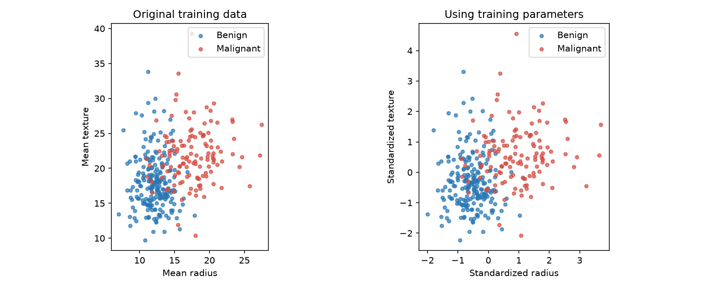

# Week 05 — NumPy, Standardizer, and Visualization

Build three interfaces, then plot the training patients. Complete five expressions; keep your Week 1–4 functions.

| Interface | Input → return |
|---|---|
| `scaler.fit(X)` | `(n,d)` → same scaler instance; saves `mean_`, `scale_`: `(d,)` |
| `scaler.transform(X)` | `(m,d)` → standardized ndarray `(m,d)` |
| `euclidean_distance(x,y)` | `(d,), (d,)` → Python `float` |

Rows are samples; columns are features. Each distance vector describes one sample with matching feature order and scale.

**Directories:** repository root contains `tools/`, `weeks/`, `students/`; package root is `students/<name_studentnumber>/`. Run commands from **package root** unless stated otherwise. Replace `<login>` with your GitHub login. Source links below are public repository files; edit destinations are package-relative.

## Step 1 — Continue from Week 4

Check your existing work:

```sh
uv sync --frozen
uv run pytest
uv run python ../../tools/course.py test <login> 4
git status --short
```

**Pass:** Week 1–4 tests succeed. Save your work and ensure the Week 4 PR is merged. Then, from **repository root**:

```sh
git switch main
git pull --ff-only origin main
git switch -c <login>/week-05
cd students/<name_studentnumber>
```

## Step 2 — Sync materials

```sh
uv run python ../../tools/course.py sync <login> 5
uv add numpy pandas matplotlib scikit-learn
uv sync --frozen
```

**Check:** `data/week-05/train.csv` (341 training patients), `test_code/week_05.py` (demo), and `tests/test_week_05.py` are present. Keep existing tests. Source fragments require Step 3; run the full demo only after completing all exercises.

## Step 3 — Integrate the starter once

| Source | Destination / action |
|---|---|
| [01_linalg.py](fragments/01_linalg.py) | **Append** the complete fragment to `src/mini_ml/linalg.py`; keep Week 4 functions. |
| [02_preprocessing.py](fragments/02_preprocessing.py) | **Create** `src/mini_ml/preprocessing.py` from the complete fragment. |

Edit these integrated functions in later steps; do not paste fragments again.

```sh
uv run python -c "from mini_ml.preprocessing import Standardizer; from mini_ml.linalg import euclidean_distance; print('Imports passed')"
```

**Pass:** `Imports passed`. Calling an unfinished exercise will raise `NotImplementedError` with a hint.

## Step 4 — NumPy essentials

| Week 4 | NumPy |
|---|---|
| `shape(matrix)` | `X.shape` |
| `transpose(matrix)` | `X.T` |
| `matmul(A, B)` | `A @ B` (`*` multiplies entries) |

`axis=0` reduces rows, giving one value per feature. Broadcasting applies `(n,d) - (d,) → (n,d)`. Review the [Intro to NumPy slides](../../teaching/intro-to-numpy/README.md) and [broadcasting reference](https://numpy.org/doc/stable/user/basics.broadcasting.html) if needed.

**Source:** Instructor-designed example using Week 4 functions · **Purpose:** runnable practice · **Destination:** create `test_code/week_05_practice.py`.

```python
import numpy as np
from mini_ml.linalg import shape, transpose, matmul, euclidean_distance
from mini_ml.preprocessing import Standardizer
X = np.array([[1, 10], [3, 10]], dtype=float)
B = np.array([[1], [2]])
assert shape(X.tolist()) == X.shape == (2, 2)
np.testing.assert_allclose(transpose(X.tolist()), X.T)
np.testing.assert_allclose(matmul(X.tolist(), B.tolist()), X @ B)
np.testing.assert_allclose(X @ B, [[21], [23]])
np.testing.assert_allclose(X.mean(axis=0), [2, 10])
np.testing.assert_allclose(X - X.mean(axis=0), [[-1, 0], [1, 0]])
```

```sh
uv run python test_code/week_05_practice.py
```

**Pass:** no assertion errors. `scaler = Standardizer()` creates an instance of the class. Its methods use `self` to save and read attributes such as `self.mean_`. `return self` returns that same instance, allowing `scaler = Standardizer().fit(X)`.

## Step 5 — Complete fit

**Edit:** `Standardizer.fit` in `src/mini_ml/preprocessing.py`: replace its three placeholders using feature-wise `mean`, `std`, and `where`.

| Training feature in `[[1,10],[3,10]]` | Mean | std (`ddof=0`) | Saved scale |
|---|---:|---:|---:|
| First | 2 | 1 | 1 |
| Second | 10 | 0 | 1 |

Use `axis=0`. Population standard deviation divides squared deviations by **n** (`ddof=0`), unlike Week 3's default **n−1**. Replace zero scales with 1 to avoid division by zero. References: [NumPy std](https://numpy.org/doc/stable/reference/generated/numpy.std.html), [StandardScaler](https://scikit-learn.org/stable/modules/generated/sklearn.preprocessing.StandardScaler.html).

**Source:** Instructor-designed example; [Standardizer.fit](fragments/02_preprocessing.py) · **Purpose:** fit checkpoint · **Destination:** append to `test_code/week_05_practice.py`.

```python
scaler = Standardizer()
assert scaler.fit(X) is scaler
np.testing.assert_allclose(scaler.mean_, [2, 10])
np.testing.assert_allclose(scaler.scale_, [1, 1])
assert scaler.n_features_in_ == 2
```

```sh
uv run python test_code/week_05_practice.py
uv run pytest -q tests/test_week_05.py -k fit_by_feature
```

**Pass:** no assertion errors; four fit cases pass, even with transform and distance unfinished.

## Step 6 — Complete transform

**Edit:** `Standardizer.transform` in `src/mini_ml/preprocessing.py`. Fill `Z = (X − mean_train) / scale_train` using saved parameters. Keep validation; new batches may have different row counts, but must retain feature count and order. Do not fit again inside transform.

**Source:** Instructor-designed example; [Standardizer.transform](fragments/02_preprocessing.py) · **Purpose:** transform checkpoint · **Destination:** append to `test_code/week_05_practice.py`.

```python
np.testing.assert_allclose(scaler.transform(X), [[-1, 0], [1, 0]])
np.testing.assert_allclose(scaler.transform([[5, 10], [5, 12]]), [[3, 0], [3, 2]])
```

```sh
uv run python test_code/week_05_practice.py
uv run pytest -q tests/test_week_05.py -k 'transform or mutation or unfitted or refit'
```

**Pass:** both expected arrays match. A constant training feature can change later: `(12−10)/1 = 2`.

## Step 7 — Complete vector distance

**Edit:** `euclidean_distance` in `src/mini_ml/linalg.py`. For two `(d,)` vectors, compute `sqrt(sum((xᵢ−yᵢ)²))` using NumPy and return a Python float. Keep the supplied validation.

**Source:** Instructor-designed 3–4–5 example; [euclidean_distance](fragments/01_linalg.py) · **Purpose:** distance checkpoint · **Destination:** append to `test_code/week_05_practice.py`.

```python
assert euclidean_distance([0, 0], [3, 4]) == 5.0
```

```sh
uv run python test_code/week_05_practice.py
uv run pytest -q tests/test_week_05.py -k distance
```

**Pass:** result is `5.0`; distance tests pass. `[0,0]` is a vector; `[[0,0]]` is a matrix.

## Step 8 — Predict the effect of scale

Fit `[[0,0],[2,200]]`, giving scale `[1,100]`. Query `[1,100]`; candidates A=`[3,100]`, B=`[1,200]`. **Predict the nearest candidate before running.**

**Source:** [demo.py](demo.py), instructor-designed scale experiment · **Purpose:** runnable experiment · **Destination:** append to `test_code/week_05_practice.py`.

```python
scale_model = Standardizer().fit([[0, 0], [2, 200]])
query, candidates = [1, 100], [[3, 100], [1, 200]]
query_scaled = scale_model.transform([query])[0]
candidates_scaled = scale_model.transform(candidates)
raw = [euclidean_distance(query, p) for p in candidates]
scaled = [euclidean_distance(query_scaled, p) for p in candidates_scaled]
assert raw == [2, 100] and scaled == [2, 1]
print("Nearest candidate: raw=A; standardized=B")
```

```sh
uv run python test_code/week_05_practice.py
```

| Distance to query | A | B | Nearest |
|---|---:|---:|---|
| Original | 2 | 100 | A |
| Standardized | 2 | 1 | B |

## Step 9 — Plot the patient distribution

Run the supplied demo; after it succeeds, optionally customize its plotting section.

```sh
uv run python test_code/week_05.py
```

**Pass:** `StandardScaler reference checks passed.` **Output:** `test_code/week_05_scaling.png`.



Each point represents one of the same 341 training patients; diagnosis labels are used only for color. Left: original mean radius/texture. Right: standardized using training parameters. Both panels use equal-aspect coordinates.

1. What changed about the axis scales and spread?
2. Do the two classes still overlap?

Standardization adjusts feature scales; it does not guarantee class separation.

*Source: [demo.py](demo.py), synced to `test_code/week_05.py`; [UCI WDBC](https://archive.ics.uci.edu/dataset/17/breast+cancer+wisconsin+diagnostic), the same training partition as Week 4.*

## Step 10 — Verify and submit

**Edit:** add one original distance or standardizer case to `tests/test_week_05.py`, preserving the [supplied tests](student_tests/test_week_05.py).

```sh
uv run pytest -q tests/test_week_05.py
uv run pytest -q
uv run python ../../tools/course.py test <login> 5
git status --short
```

**Pass:** all three checks succeed. Then commit from package root:

```sh
git add src/mini_ml/linalg.py src/mini_ml/preprocessing.py tests/test_week_05.py pyproject.toml uv.lock
git commit -m "Implement NumPy standardization and visualize training patients"
git push -u origin <login>/week-05
```

Open a PR to `main` with **test commands/results, scale-experiment observations, and patient-plot observations**. Keep `test_code/` local and ignored; do not commit `.venv` or external data.

<details>
<summary>Reference test counts</summary>

Before your extra case: W5 supplied tests **31**, cumulative student tests **89**, course acceptance **38**. Your added tests can increase student test totals.

</details>

<details>
<summary>Troubleshooting</summary>

- **Import fails:** confirm package root, run `uv sync`, and check fragment destinations/indentation. Preserve the original `linalg.py` functions.
- **Missing CSV/demo/tests:** rerun sync; check login/folder mapping and the published week.
- **TODO error:** replace the indicated placeholder; importing an unfinished starter is allowed.
- **Wrong means or sklearn mismatch:** check `axis=0`, `ddof=0`, feature order, and zero-scale fallback. Do not fit separately by diagnosis.
- **Feature/broadcasting error:** supply a nonempty `(m,d)` matrix with the training feature count. Transform must reuse saved parameters.
- **Plot has one color:** check diagnosis masks. Open the saved PNG if your terminal cannot display a window.
- **Existing branch:** use `git switch <login>/week-05`. For push failures, check your branch and GitHub authorization.

</details>
