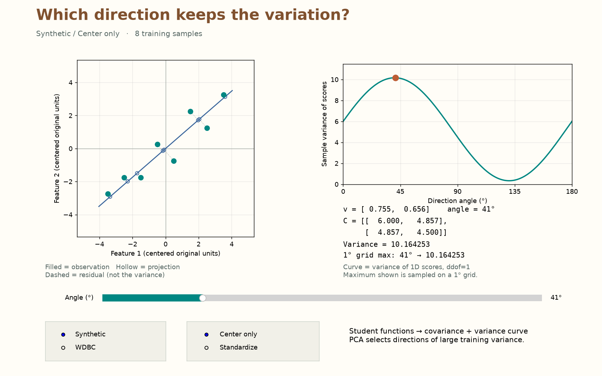
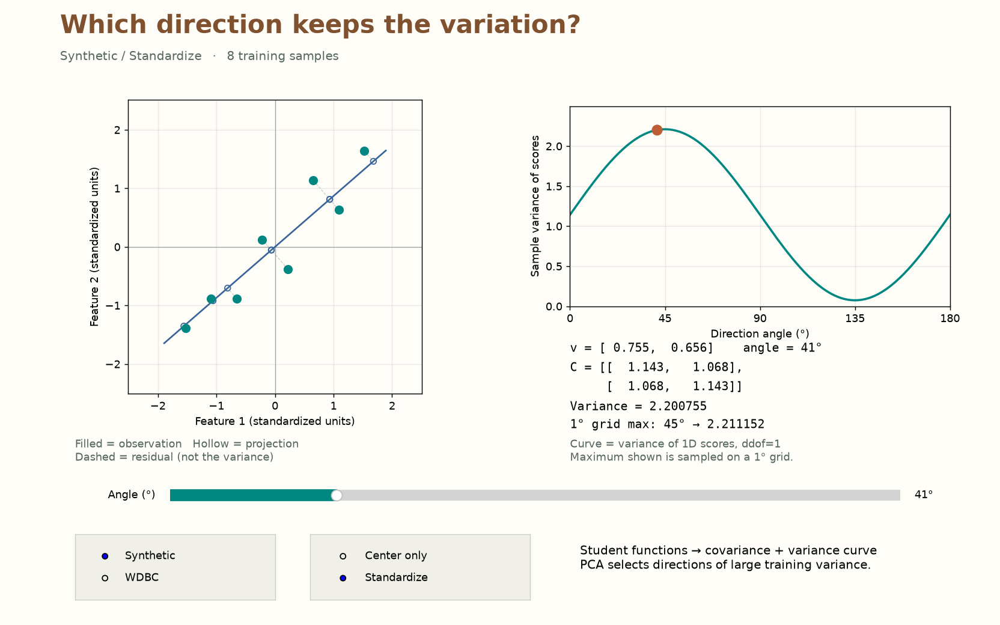
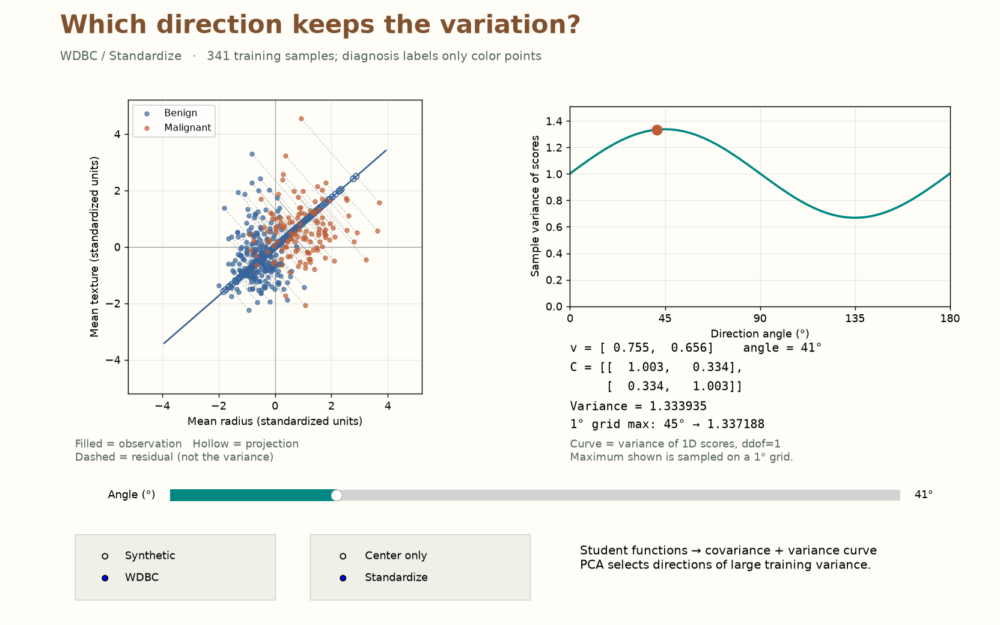
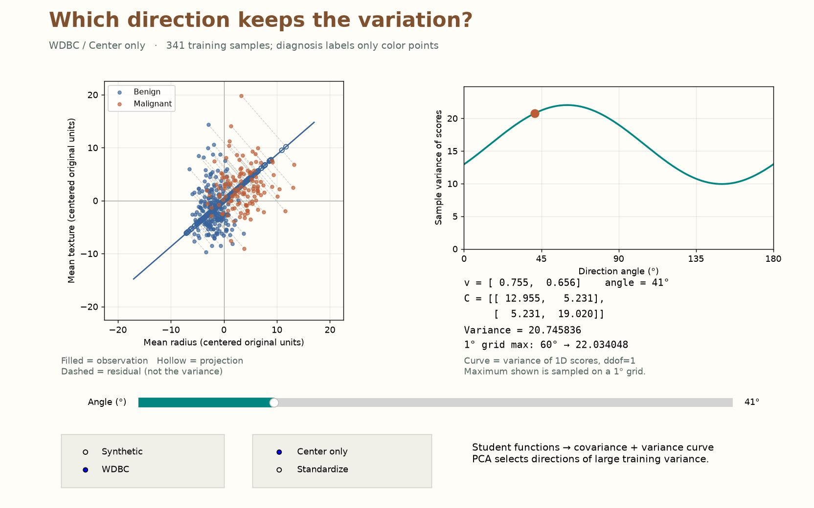

# Week 06 — Which Direction Keeps the Variation?

Complete **three functions / four expressions**, then use them to drive an interactive variance explorer. Keep your Week 1–5 functions. The instructor supplies the interface and all W6 tests; **you do not need to write or extend tests**.

`X: (n,d)` means rows = samples, columns = features. **Array-like** means numeric lists or ndarrays that can be converted to a float64 ndarray.

| Interface | Input | Return |
|---|---|---|
| `center(X, mean=None)` | `X: (n,d)`; optional mean `(d,)` | tuple of float64 ndarrays: centered `(n,d)`, mean `(d,)` |
| `covariance_matrix(X_centered)` | centered `(n,d)`, `n ≥ 2` | float64 ndarray `(d,d)` |
| `variance_along_direction(X_centered, direction)` | centered `(n,d)`; nonzero direction `(d,)` | Python `float` |

**Directories:** repository root contains `tools/`, `weeks/`, `students/`; package root is `students/<name_studentnumber>/`. All commands below run from **package root** unless stated otherwise. Replace `<login>` with your GitHub login. Source links are public; edit destinations are package-relative.

## Step 1 — Continue from Week 5

Check your existing package:

```sh
uv sync --frozen
uv run pytest -q
uv run python ../../tools/course.py test <login> 5
git status --short
```

**Pass:** earlier tests succeed. Save your work and ensure your W5 PR is merged. From **repository root**:

```sh
git switch main
git pull --ff-only origin main
git switch -c <login>/week-06
cd students/<name_studentnumber>
```

## Step 2 — Sync the supplied materials

```sh
uv run python ../../tools/course.py sync <login> 6
uv sync --frozen
uv run python -c "import numpy, pandas, matplotlib; print('Dependencies available')"
```

**Check:** `test_code/week_06.py`, `data/week-06/train.csv`, and `tests/test_week_06.py` exist. W6 uses existing W5 dependencies. Sync preserves your source and existing tests; it does not integrate the starter. Run the complete demo after Step 7.

## Step 3 — Integrate the starter once

| Public source | Destination / action |
|---|---|
| [01_decomposition.py](fragments/01_decomposition.py) | **Create** `src/mini_ml/decomposition.py` from the complete fragment. |

Edit this file in Steps 4–6; do not paste the fragment again. Keep the supplied validation and direction normalization. Calculations use the converted ndarray `array`, not the original `X` list.

```sh
uv run python -c "from mini_ml.decomposition import center, covariance_matrix, variance_along_direction; print('Imports passed')"
```

**Pass:** `Imports passed`. Calling an incomplete function raises `NotImplementedError: TODO: ...`.

## Step 4 — Center the samples

**Edit:** `center` in `src/mini_ml/decomposition.py`: fill **column means** (`axis=0`) and **broadcast subtraction**. If a mean is supplied, reuse it. Return `(X_centered, mean)`; do not modify inputs.

| Hand calculation | Value |
|---|---|
| `X` | `[[1,2],[2,3],[3,4]]` |
| `mean` | `[2,3]` |
| `X_centered` | `[[-1,-1],[0,0],[1,1]]` |

**Source:** Instructor-designed example; [center](fragments/01_decomposition.py) · **Purpose:** checkpoint · **Destination:** create `test_code/week_06_practice.py`.

```python
import numpy as np
from mini_ml.decomposition import center, covariance_matrix, variance_along_direction

X = np.array([[1, 2], [2, 3], [3, 4]], dtype=float)
Xc, mean = center(X)
np.testing.assert_allclose(mean, [2, 3])
np.testing.assert_allclose(Xc, [[-1, -1], [0, 0], [1, 1]])
new_centered, saved_mean = center([[5, 6]], mean=mean)
np.testing.assert_allclose(new_centered, [[3, 3]])
np.testing.assert_allclose(saved_mean, mean)
```

```sh
uv run python test_code/week_06_practice.py
uv run pytest -q tests/test_week_06.py -k center_columns
```

**Pass:** assertions and selected tests pass. A new batch need not have zero mean after applying the training mean; do not estimate another mean for it.

## Step 5 — Calculate sample covariance

**Edit:** `covariance_matrix` in the same file. Fill one expression for `C = Xc.T @ Xc / (n−1)`. Shapes: `(d,n) @ (n,d) → (d,d)`. Diagonal entries are feature variances; off-diagonal entries describe how features vary together.

The supplied guard requires at least two rows and column means within `1e-10` of zero. W6 uses **sample variance (`ddof=1`)**; W5 Standardizer uses population standard deviation (`ddof=0`).

**Source:** Instructor-designed example; [covariance_matrix](fragments/01_decomposition.py) · **Purpose:** checkpoint · **Destination:** append to `test_code/week_06_practice.py`.

```python
C = covariance_matrix(Xc)
assert C.shape == (2, 2)
np.testing.assert_allclose(C, [[1, 1], [1, 1]])
np.testing.assert_allclose(C, C.T)
np.testing.assert_allclose(C.diagonal(), np.var(Xc, axis=0, ddof=1))
```

```sh
uv run python test_code/week_06_practice.py
uv run pytest -q tests/test_week_06.py -k covariance_reference
```

**Pass:** `C` is symmetric and matches the hand calculation. An `(n,n)` result usually means the multiplication order is reversed.

## Step 6 — Measure variance along a direction

**Edit:** `variance_along_direction` in the same file. The supplied code calls **your `covariance_matrix`**, checks direction shape, and normalizes its length to 1. Fill the quadratic form `v @ C @ v`; the wrapper returns a Python float.

For unit direction `v: (d,)`, scores `z = Xc @ v: (n,)`. Their sample variance is `Var(z) = v.T @ C @ v`. Comparing unit directions prevents a longer arrow from artificially increasing variance.

**Source:** Instructor-designed example; [variance_along_direction](fragments/01_decomposition.py) · **Purpose:** checkpoint · **Destination:** append to `test_code/week_06_practice.py`.

```python
assert np.isclose(variance_along_direction(Xc, [1, 1]), 2.0)
assert np.isclose(variance_along_direction(Xc, [-3, -3]), 2.0)
```

```sh
uv run python test_code/week_06_practice.py
uv run pytest -q tests/test_week_06.py -k direction
```

**Pass:** direction tests pass. Reversing or multiplying a nonzero direction does not change its variance.

## Step 7 — Compare four directions

Predict the ordering before running. Both features in the hand example vary together.

| Direction (normalized by the function) | `[1,0]` | `[0,1]` | `[1,1]` | `[1,-1]` |
|---|---:|---:|---:|---:|
| Expected variance | 1 | 1 | 2 | 0 |

**Source:** Instructor-designed example; [NumPy var](https://numpy.org/doc/stable/reference/generated/numpy.var.html) · **Purpose:** independent numerical check · **Destination:** append to `test_code/week_06_practice.py`.

```python
for direction, expected in [([1, 0], 1), ([0, 1], 1), ([1, 1], 2), ([1, -1], 0)]:
    v = np.asarray(direction, dtype=float)
    v = v / np.linalg.norm(v)
    actual = variance_along_direction(Xc, direction)
    np.testing.assert_allclose(actual, expected, atol=1e-12)
    np.testing.assert_allclose(actual, np.var(Xc @ v, ddof=1), atol=1e-12)
print("Hand directions: 1, 1, 2, 0; projection checks passed.")
```

```sh
uv run python test_code/week_06_practice.py
```

**Pass:** the printed message confirms both calculations agree. NumPy is the reference here; the demo plots values from your functions.

## Step 8 — Explore the synthetic data

**Run:** the supplied [demo.py](demo.py), synced to `test_code/week_06.py`. It opens a native desktop window; no frontend editing is required.

```sh
uv run python test_code/week_06.py
```

**Pass:** start at **Synthetic / Center only / 41°**, variance about **10.164253**. Drag from 0° to 180°. The left axes stay fixed while the direction and projections move; the right marker follows your variance curve.



- Filled dot = centered observation; hollow dot = its projection `zᵢ v`; dashed segment = residual.
- Score `zᵢ = xᵢ @ v` is a **scalar coordinate along the line**. The curve measures spread of these scores, not lengths of residual segments.
- The reported maximum is the best sampled **1° grid** angle, not an exact PCA solver.

Switch to **Standardize**, then back. Both modes center the data; Standardize also divides each feature by its training standard deviation. **Normalizing the direction** is a separate operation, performed in both modes.

<details>
<summary>Expected Synthetic / Standardize view</summary>



</details>

## Step 9 — Explore the WDBC training patients

**In the same window:** choose **WDBC**, compare **Center only** and **Standardize**, and drag the angle. These are the same 341 training patients and radius/texture features as W5, in the same order. Diagnosis labels only color points; they never enter covariance or variance calculations.



1. How do the scales and the maximizing direction change between modes?
2. Do the colors still overlap along a high-variance direction? Large variance does not imply better diagnosis separation.

Here the standardized maximum is 45° because the two variances match and covariance is positive; **45° is not a general PCA rule**. W5 uses `ddof=0`, so W6's sample variances are `341/340 ≈ 1.00294`, not exactly 1.

<details>
<summary>Expected WDBC / Center only view</summary>



</details>

Close the window, then run the noninteractive checks:

```sh
uv run python test_code/week_06.py --headless
```

**Pass:** `NumPy reference checks passed for all 4 dataset/mode combinations.` Four fixed-41° PNGs are saved in `test_code/`: `week_06_synthetic_center.png`, `week_06_synthetic_standardize.png`, `week_06_wdbc_center.png`, and `week_06_wdbc_standardize.png`. These verify rendering; they do not replace operating the slider.

*Figure/data source: [demo.py](demo.py), instructor-designed synthetic points and the same [UCI WDBC](https://archive.ics.uci.edu/dataset/17/breast+cancer+wisconsin+diagnostic) training partition as W5. Interface reference: [Matplotlib Slider](https://matplotlib.org/stable/gallery/widgets/slider_demo.html). Preprocessing is fitted once per dataset/mode; dragging does not fit again.*

## Step 10 — Verify and submit

Run the [supplied tests](student_tests/test_week_06.py) unchanged; **no original test cases are required for W6**.

```sh
uv run pytest -q tests/test_week_06.py
uv run pytest -q
uv run python ../../tools/course.py test <login> 6
git status --short
```

**Pass:** all three commands succeed. From package root:

```sh
git add src/mini_ml/decomposition.py tests/test_week_06.py
git commit -m "Implement covariance and explore variance directions"
git push -u origin <login>/week-06
```

Open a PR to `main`: include **test results, one screenshot of your interactive window, and short observations about scale and class overlap**. Keep images and practice in ignored `test_code/`; attach the screenshot to the PR. Do not commit data or `.venv`.

<details>
<summary>Reference test counts</summary>

Verified reference package: **60 W6 tests**, **149 cumulative student tests**, and **72 cumulative teacher acceptance tests**. Earlier student-added cases can increase student totals. CI runs its independent acceptance outside your editable tests.

</details>

<details>
<summary>Troubleshooting</summary>

- **Import/dependency error:** confirm package root, `uv sync --frozen`, and the Step 3 destination. If a W5 dependency is absent, use `uv add numpy pandas matplotlib` and commit dependency files too.
- **Missing demo/CSV/tests:** check your registered login and published week, then sync. Sync preserves existing files; do not overwrite saved experiments when obtaining a revised demo.
- **TODO error:** finish the named expression; keep the guards. A successful import does not mean all expressions are complete.
- **Shape/centering error:** use `(n,d)` data, `(d,)` vectors and `axis=0`. Covariance needs at least two centered rows. A batch transformed with an older training mean may not itself be centered.
- **Wrong variance:** check `n−1`, multiplication order and the quadratic form. Do not re-standardize inside the direction function.
- **No native GUI:** run in a desktop terminal with GUI-enabled Python/Matplotlib. If `MPLBACKEND=Agg` is set, unset it. `--headless` provides checks/PNGs, not an interactive window; ask the instructor to help enable a desktop backend.

</details>

Next week: use several directions together to represent and reconstruct observations. This week evaluates one direction at a time; PCA will later select directions automatically.
