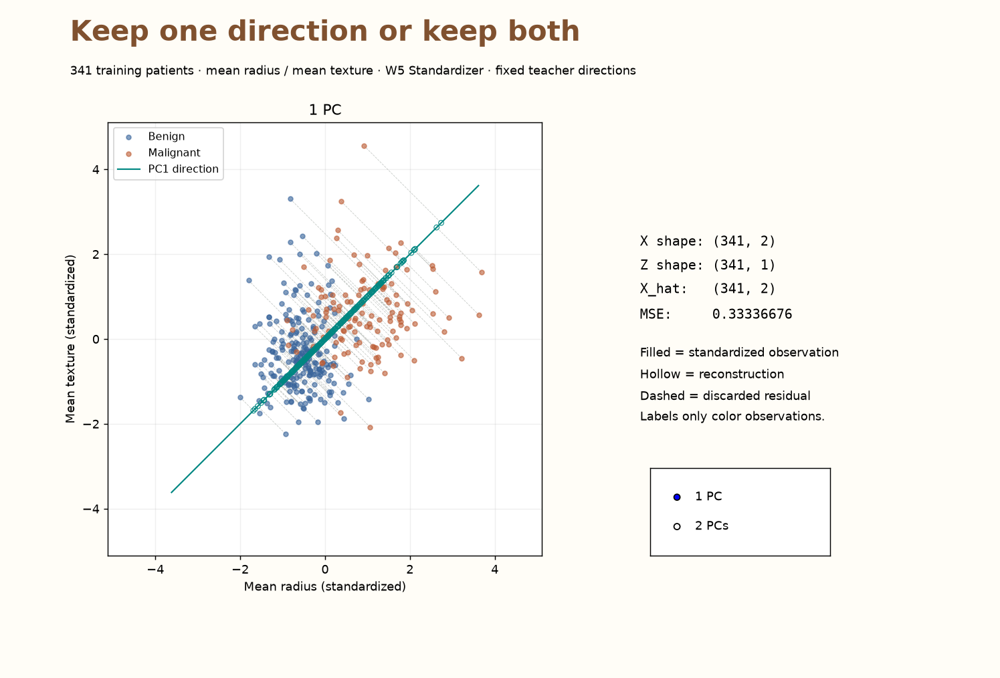
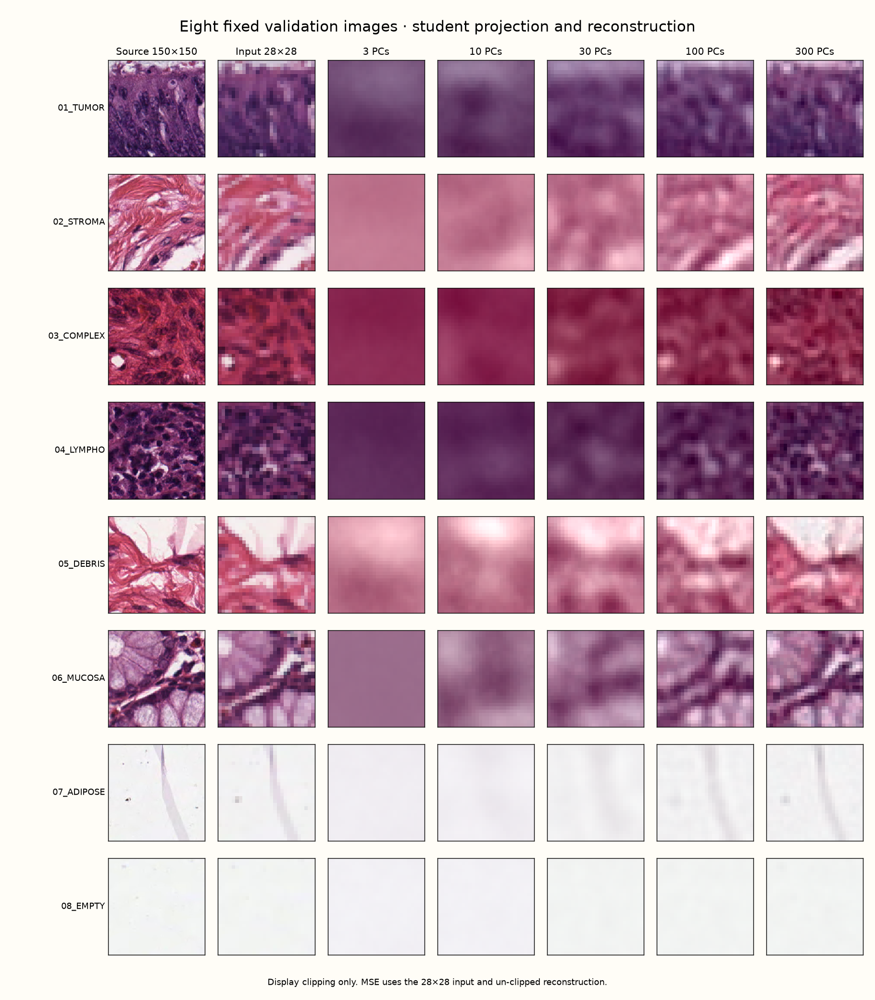
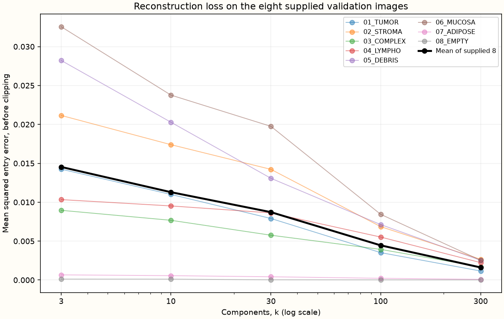

# Week 07 — Projection, Reconstruction, and Information Loss

Complete **three functions / three expressions** in your existing `mini_ml.decomposition` module. Use them to reconstruct WDBC observations and pathology images. The instructor supplies directions, plotting and all W7 tests; **no original test cases are required**.

The [12-slide offline lecture](../../teaching/week07-projection/index.html) explains the geometry. Your Python demo uses your functions; the lecture displays independently verified reference results.

`X: (n,d)` means rows = observations, columns = features. `components: (k,d)` contains one unit direction per row; rows are mutually orthogonal. Each observation has its own k scores. Functions accept numeric array-like inputs and leave inputs unchanged.

| Interface | Input → return |
|---|---|
| `project(X, mean, components)` | `(n,d), (d,), (k,d)` → float64 scores `(n,k)` |
| `reconstruct(Z, mean, components)` | `(n,k), (d,), (k,d)` → float64 reconstruction `(n,d)` |
| `reconstruction_error(X, X_hat)` | two matching `(n,d)` arrays → Python `float` |

**Locations:** the repository root contains `tools/`, `weeks/`, `students/`. Your package root is `students/<name_studentnumber>/`. Run commands from **package root** unless stated otherwise; replace `<login>` with your GitHub login. Sync becomes available after the instructor publishes Week 7.

## Step 1 — Continue from Week 6

Check your existing package:

```sh
uv sync --frozen
uv run pytest -q
uv run python ../../tools/course.py test <login> 6
git status --short
```

**Pass:** earlier tests succeed. Save your work and ensure your W6 PR is merged. From **repository root**:

```sh
git switch main
git pull --ff-only origin main
git switch -c <login>/week-07
cd students/<name_studentnumber>
```

## Step 2 — Sync the supplied materials

```sh
uv run python ../../tools/course.py sync <login> 7
uv sync --frozen
uv run python -c "import numpy, pandas, matplotlib; print('Dependencies available')"
```

**Check:** `test_code/week_07.py`, `tests/test_week_07.py` and `data/week-07/` exist. The data folder contains `train.csv`, `wdbc_basis.npz`, `pca_basis.npz` and `provenance.json`.

The compressed pathology bundle is about 5.83 MB: a training-fitted mean, 300 directions and eight fixed validation examples, one per class. You need neither sklearn nor the full image archive. Sync adds missing support files and preserves existing edits; it does not integrate source fragments.

## Step 3 — Append the starter once

| Public source | Destination / action |
|---|---|
| [01_decomposition.py](fragments/01_decomposition.py) | **Append once** to `src/mini_ml/decomposition.py`, after your Week 6 code. |

Keep `center`, `covariance_matrix`, `variance_along_direction` and their helpers. Do not replace the file or paste W7 twice. Keep the supplied checks for finite, nonempty arrays, matching shapes and an orthonormal basis (`atol=1e-8`); fill only the three marked expressions.

```sh
uv run python -c "from mini_ml.decomposition import project, reconstruct, reconstruction_error; print('Imports passed')"
```

**Pass:** `Imports passed`. Calling an unfinished function raises `NotImplementedError: TODO: ...`.

## Step 4 — Project observations into scores

**Edit:** `project`. Subtract the supplied mean, then multiply by the transposed component matrix. Shapes: `(n,d) @ (d,k) → (n,k)`.

The mean and directions belong to training data. Reuse them on a new batch; do not calculate a new mean inside `project`. A negative score selects the negative side of the same direction.

**Source:** instructor-designed example; [project starter](fragments/01_decomposition.py). **Purpose:** hand-calculation checkpoint. **Destination:** create `test_code/week_07_practice.py`.

```python
import numpy as np
from mini_ml.decomposition import project, reconstruct, reconstruction_error

X = np.array([[2., 3.], [-2., -3.]])
mean = np.array([0., 0.])
components = np.array([[1., 0.]])
Z = project(X, mean, components)
assert Z.shape == (2, 1)
np.testing.assert_allclose(Z, [[2.], [-2.]])
saved_mean = np.array([10., 20.])
new_X = np.array([[12., 23.]])
np.testing.assert_allclose(project(new_X, saved_mean, components), [[2.]])
```

```sh
uv run python test_code/week_07_practice.py
uv run pytest -q tests/test_week_07.py -k projection
```

**Pass:** scores are `[[2], [-2]]`, not two reconstructed points. A new batch need not have zero mean after applying the training mean.

## Step 5 — Reconstruct in the original feature space

**Edit:** `reconstruct`. Multiply scores by component rows, then add the supplied mean. Shapes: `(n,k) @ (k,d) → (n,d)`.

The centered reconstruction is a weighted sum of directions. Adding the mean returns it to the original coordinates. Keeping only the x-axis loses the y-coordinate.

**Source:** instructor-designed example; [reconstruct starter](fragments/01_decomposition.py). **Purpose:** check the lost direction and saved mean. **Destination:** append to `test_code/week_07_practice.py`.

```python
X_hat = reconstruct(Z, mean, components)
np.testing.assert_allclose(X_hat, [[2., 0.], [-2., 0.]])
np.testing.assert_allclose(X - X_hat, [[0., 3.], [0., -3.]])
np.testing.assert_allclose(
    reconstruct([[2.]], saved_mean, components), [[12., 20.]]
)
```

```sh
uv run python test_code/week_07_practice.py
uv run pytest -q tests/test_week_07.py -k reconstruction
```

**Pass:** output has two features again. Recovering the shape does not recover discarded information.

## Step 6 — Measure reconstruction error

**Edit:** `reconstruction_error`. Square each entry of `X - X_hat`, then take the mean over **all n × d entries**. Return a Python float. MSE has no `n−1` correction.

Squared errors are `[[0,9],[0,9]]`, so `MSE = 18 / 4 = 4.5`.

**Source:** instructor-designed example; [NumPy mean](https://numpy.org/doc/stable/reference/generated/numpy.mean.html). **Purpose:** check the MSE denominator. **Destination:** append to `test_code/week_07_practice.py`.

```python
error = reconstruction_error(X, X_hat)
assert isinstance(error, float)
np.testing.assert_allclose(error, 4.5)
np.testing.assert_allclose(error, np.mean(np.square(X - X_hat)))
```

```sh
uv run python test_code/week_07_practice.py
uv run pytest -q tests/test_week_07.py -k mse
```

**Pass:** `4.5`. An answer of `9` averages row-wise squared distances but forgets to average over features.

## Step 7 — Keep one or both directions

Predict before running. A full orthonormal basis retains all feature-space directions. Flipping a component's sign also flips its score, so reconstruction stays the same.

**Source:** instructor-designed example; [NumPy matrix multiplication](https://numpy.org/doc/stable/reference/generated/numpy.matmul.html). **Purpose:** independent geometry checks. **Destination:** append to `test_code/week_07_practice.py`.

```python
full_basis = np.eye(2)
full_scores = project(X, mean, full_basis)
full_reconstruction = reconstruct(full_scores, mean, full_basis)
np.testing.assert_allclose(full_reconstruction, X)
np.testing.assert_allclose(reconstruction_error(X, full_reconstruction), 0.)
flipped = -components
flipped_scores = project(X, mean, flipped)
np.testing.assert_allclose(flipped_scores, -Z)
np.testing.assert_allclose(reconstruct(flipped_scores, mean, flipped), X_hat)
print("Hand checks passed: scores, saved mean, MSE 4.5, full-basis recovery.")
```

```sh
uv run python test_code/week_07_practice.py
uv run pytest -q tests/test_week_07.py
```

**Pass:** the message prints and all W7 tests pass. The image basis retains at most 300 of 2352 directions; full recovery in 2D does not imply exact image recovery with 300 components.

## Step 8 — Explore the WDBC observations

```sh
uv run python test_code/week_07.py --dataset wdbc
```

The native window uses the same 341 training patients and two features as W6. Your W5 `Standardizer` scales the data; your W7 functions project and reconstruct using supplied fixed directions. Toggle **one versus two components** and inspect observations, reconstructions, residuals and MSE.



**Pass:** with two directions, MSE is zero within floating-point precision. Coordinates and errors are in **standardized feature units**. Labels color observations only; they do not determine directions.

Explain: which part is lost with one component? Does low reconstruction error establish useful diagnosis prediction?

## Step 9 — Reconstruct the pathology images

Close the WDBC window, then run:

```sh
uv run python test_code/week_07.py
```

Select the eight examples and compare **3, 10, 30, 100 and 300 components**. All images share one training mean and basis; `components[:k]` selects k directions. Compare the source, model input and reconstruction, plus the selected image's error and the eight-image average.



| Stage | Meaning |
|---|---|
| Source 150 × 150 | Original RGB tissue tile |
| Model input 28 × 28 | BILINEAR resize, C-order flatten and divide by 255: 2352 features |
| Reconstruction 28 × 28 | Your scores combined with retained directions and training mean |

**Pass:** increasing k along the same ordered orthonormal basis does not increase MSE. Eight-image averages, before display clipping, approximately match:

| k | Eight-example MSE |
|---:|---:|
| 3 | 0.01452992548 |
| 10 | 0.01129047339 |
| 30 | 0.00872196541 |
| 100 | 0.00445718538 |
| 300 | 0.00161293938 |



MSE compares with the **28 × 28 input**, not the 150 × 150 source. More components cannot restore detail already removed by resizing. Clip RGB to `[0,1]` only for display; MSE uses unclipped reconstruction. `/255` rescales intensities and is not stain normalization.

The eight examples are a teaching subset, not the entire 1000-image validation partition. PCA was fitted on 3000 training images only; test data is not used. W7 trains no classifier and does not interpret components as tissue identities.

*Data: [Kather et al. (2016), Collection of textures in colorectal cancer histology](https://doi.org/10.5281/zenodo.53169), CC BY 4.0. Images are resized/reconstructed derivatives. Splitting is by tile; patient independence is unestablished. See [provenance.json](data/provenance.json) for source, split and hashes. Interface: [Matplotlib RadioButtons](https://matplotlib.org/stable/gallery/widgets/radio_buttons.html).*

## Step 10 — Verify and submit

Close the window and run:

```sh
uv run python test_code/week_07.py --headless
uv run pytest -q tests/test_week_07.py
uv run pytest -q
uv run python ../../tools/course.py test <login> 7
git status --short
```

**Pass:** independent reference checks and all tests succeed. Headless saves `week_07_wdbc.png`, `week_07_tissue_reconstruction.png` and `week_07_tissue_mse.png` in `test_code/`. Open and operate the native windows too; PNG checks do not replace the interactive experiment.

From package root:

```sh
git add src/mini_ml/decomposition.py tests/test_week_07.py
git commit -m "Implement projection, reconstruction and MSE"
git push -u origin <login>/week-07
```

Open a PR to `main`. Attach reconstruction/MSE figures, include test results and answer:

1. How does a component differ from an observation's score?
2. Why reuse the training mean for projection and reconstruction?
3. What changes as k increases? What cannot return after resizing?
4. Which images does the plotted average cover? Does low MSE establish good classification?

Keep experiments/figures in ignored `test_code/`; attach figures to the PR. Do not commit supplied data or `.venv`. No additional tests are required for W7.

<details>
<summary>Troubleshooting</summary>

- **Week unpublished / missing NPZ:** update main after release and use its current sync tool; older versions copy CSV only. Sync preserves existing files. Save experiments before obtaining a revised demo.
- **Import error:** run from package root; append W7 once after W6 instead of replacing the module.
- **TODO error:** fill the named expression; import success alone does not complete the exercise.
- **Wrong shape:** directions are rows `(k,d)`; projection returns `(n,k)`, reconstruction `(n,d)`.
- **Orthonormality error:** retain the supplied float64 basis without rounding/rescaling.
- **Wrong mean/MSE:** reuse the training mean; add it back; average over samples and features.
- **No native GUI:** use desktop Matplotlib; unset `MPLBACKEND=Agg` if present. `--headless` provides checks/PNGs. Ask the instructor to help enable a desktop backend.

</details>

Next week, `PCA.fit` learns and saves mean/directions. Its `transform` and `inverse_transform` reuse these functions.
